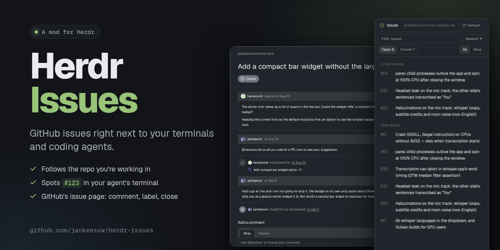
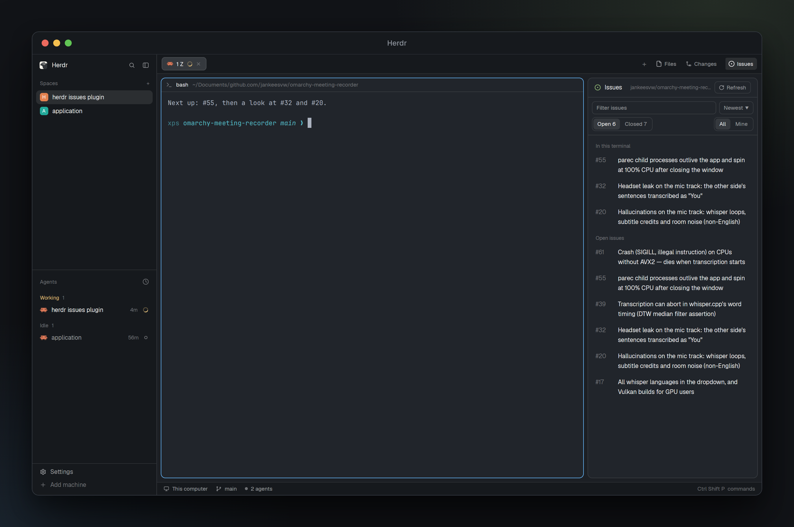
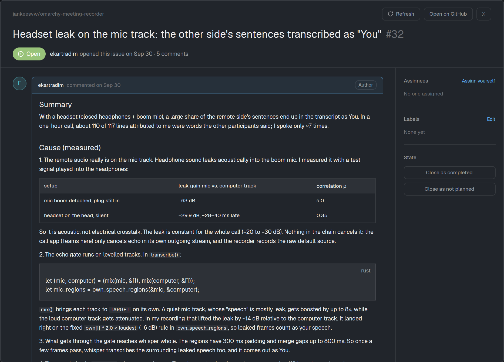

# Herdr Issues



A GitHub and Gitee issues panel for the [Herdr](https://herdr.dev) desktop app. It sits next to Files and Changes in the tab bar, follows the repository of the terminal you're in (github.com or gitee.com), and lists issues and pull requests. Clicking one shows it in the panel itself — no dialog over your terminals — where you can comment, edit labels, assign yourself, change the title and body of your own issues, close and reopen.



- **Follows your focus.** The panel shows the issues of the repository the focused terminal is in, GitHub's or Gitee's; a folder with both remotes shows GitHub's. Each space remembers its own repository, so a terminal outside any repository keeps showing that one. A remote named through an ssh alias (`git@github-work:owner/repo`) is followed to the machine ssh says it stands for.
- **In this terminal.** Issue numbers (`#123`, or `#IKS135` on Gitee) and issue or pull request links on the focused terminal's screen are listed at the top, newest first, so an agent's "fixed #55" is one click away.
- **Issues and pull requests.** A switch beside the filter shows either; merged pull requests read as merged, drafts as draft.
- **Open and closed, sorted your way.** Filter on open or closed, all or assigned to you, or by text, and sort the way GitHub does: newest, oldest, recently updated, least recently updated, most commented.
- **Copy it.** Click an issue's number in the list to copy it (`#123`, `#IKS135` on Gitee), and copy the link, `owner/repo#123` or `#123` from the issue view, or from a right-click on the row.
- **A rich box for everything you write.** A comment, a new issue's body and the body of an issue you are editing are the same box: a toolbar over it writes the markdown under your selection — bold, italic, strikethrough, code, a code block, quote, bulleted, numbered and task lists, a heading, a link that takes the URL off your clipboard, and an image — and Write, Preview and Split show the result as you type. An image is a link: paste one with alt text and a width, drag a picture onto the box, or paste a screenshot from the clipboard, which is uploaded to a secret gist on your own GitHub account (neither GitHub's nor Gitee's comment API takes a file) and linked from there.
- **Start work on it.** From an issue or a pull request, one dialog picks the coding agent installed on this machine (Claude Code, Codex, Gemini, opencode, Cursor, pi, …), its model and reasoning effort, the branch and where it is checked out, and the brief the agent starts with — then makes a git worktree beside your checkout and opens a space there with the agent already working. A pull request can be reviewed read-only, handed over to be fixed, or opened with its base merged in for its conflicts to be resolved. The agent pushes nothing and writes nothing back to the platform; the panel's own Review and Merge buttons do, when you press them.
- **Fast.** Issues are cached per repository. After the first fetch, only what changed since the last sync is fetched, every 30 seconds while the panel is open.
- **Read a pull request's changes.** A pull request opens on its conversation with a tab beside it for its files: every file with its additions and deletions, its patch under it with both line numbers down the side and the added and removed lines tinted as github.com tints them, and a click on a file's row folding its patch away. The list is read-only — nothing is written back to the platform. On Gitee the same files and patches come from its own pull request endpoint.
- **Review it, and merge it.** Under the comment box, Review asks Approve or Request changes, and the box's text becomes the review. At the foot of the conversation a Merge box says where the pull request stands — mergeable, blocked by a review or a check, or conflicting with its base — and offers Merge as a merge commit, a squash or a rebase. A conflicting branch offers Resolve conflicts instead: a worktree on the pull request's own head branch with its base already merged into it, the conflicted files listed in the agent's brief, and the push left to you.
- **A GitHub-style view, in the panel.** The timeline as github.com draws it: comments with avatars, roles and reactions, and the events between them (labels, assignments, references, commits, closing). Markdown with tables, code and screenshots (also from private repositories), `#123` links that open in place with Back, a comment box with a markdown toolbar and a live preview, an Edit on the first card that turns the title and body of an item you wrote into a field and that same box in place, and a sidebar for assignees, labels, milestone, linked pull requests and participants. On Gitee the timeline is its comments, the state pill shows Gitee's own state (意向, 进行中, 已完成, 已拒绝), and linked pull requests aren't listed. In a narrow panel the sidebar folds into a line under the title, and under 430px the hint text and the longer button labels give way first; drag the panel wider and they come back. A title with Chinese in it wraps as text with its number on the next line, since it has no spaces to break at.



## Install

For GitHub repositories you need the [GitHub CLI](https://cli.github.com) (`gh`), logged in with `gh auth login`. Gitee needs a personal access token instead, see [Gitee](#gitee). A repository on another machine (a space on a remote machine) is read on that machine, with its own `gh`; a machine without one has this computer's `gh` read it instead.

Clone this repository and link the mod into Herdr's home, so a `git pull` updates it:

```sh
git clone https://github.com/jankeesvw/herdr-issues.git ~/Documents/github.com/jankeesvw/herdr-issues
ln -s ~/Documents/github.com/jankeesvw/herdr-issues/mods/issues ~/.config/herdr-app/mods/issues
cp ~/Documents/github.com/jankeesvw/herdr-issues/layouts/main-issues.json ~/.config/herdr-app/layouts/
herdr-app do layout.switch --name main-issues
```

`main-issues` is Herdr's own `main` layout (0.1.9) with the Issues panel and its button added. `ctrl-shift-l` switches back to any other layout.

### Your own layout

Already have a layout of your own? Add two blocks to it. The panel goes in the side panel stack with Files and Changes:

```json
{ "id": "panel-body", "type": "stack", "children": [
  { "id": "files", "type": "block", "content": { "mod": "files" } },
  { "id": "changes", "type": "block", "content": { "mod": "changes" } },
  { "id": "issues", "type": "block", "content": { "mod": "issues" } } ] }
```

And the Issues button next to the tab bar, which opens and closes that panel:

```json
{ "id": "tab-bar", "type": "row", "size": { "px": 42 }, "resizable": false, "children": [
  { "id": "tabs", "type": "block", "window_drag": true, "content": { "mod": "tabs" } },
  { "id": "issues-button", "type": "block", "size": { "px": 78 }, "window_drag": true, "content": { "mod": "issues", "props": { "button": true } } } ] }
```

The mod also works as a pane of its own: `herdr-app do pane.split --direction right --mod issues`.

## Gitee

A folder whose remotes are on gitee.com shows its Gitee issues in the same panel; the header says Gitee next to the repository. A folder with a remote on both platforms shows GitHub's, as it always has.

Gitee reads work without credentials at 60 requests an hour, which runs out quickly, and private repositories need a token. Create one at [gitee.com/profile/personal_access_tokens](https://gitee.com/profile/personal_access_tokens) with the **issues** and **notes** scopes, and write it into this file:

```sh
mkdir -p ~/.config/herdr-app/data/issues
pbpaste > ~/.config/herdr-app/data/issues/gitee-token
```

The mod reads the token per request. It goes in the query string of a read and in the body of a write, only ever to gitee.com, and never into a program's arguments where `ps` would show it.

How Gitee differs, and what that means here:

- Issues are identified by a string (`IKS135`), not a number, so lists show `#IKS135` and the panel sorts newest by Gitee's internal id.
- Gitee has four states (open, progressing, closed, rejected); the panel's Open covers the first two and Closed the last two, and the issue view shows Gitee's own state name and color.
- One assignee, not a list: "Assign yourself" replaces whoever had it.
- Closing as not planned isn't offered: Gitee's API refuses to set its rejected state (it can only close as completed), though issues already rejected read as not planned.
- No reactions, no timeline endpoint and no linked pull requests, so the issue view shows comments only and says so under Development.
- The incremental sync asks Gitee for issues updated since the last one (`since`), in either state.
- Pull requests are numbers there (`!14`, not `#IKS135`), their people are reviewers rather than an assignee (so "Assign yourself" is hidden), and the API reports no comment count, which leaves them out of "Most commented".

## What it runs and stores

The mod runs `gh` (on the machine of the space, for remote spaces) for GitHub repositories, calls Gitee's API v5 with `fetch` for Gitee ones, and runs `hc read` on the focused terminal to find issue numbers. It changes issues only when you press a button in the issue view. Its cache lives in `~/.config/herdr-app/data/issues/`, next to the icons, avatars and issue images it saves there (Herdr doesn't load images from a symlinked mod folder). Images on github.com are fetched with your `gh` token, which only goes to github.com; your Gitee token only goes to gitee.com.
