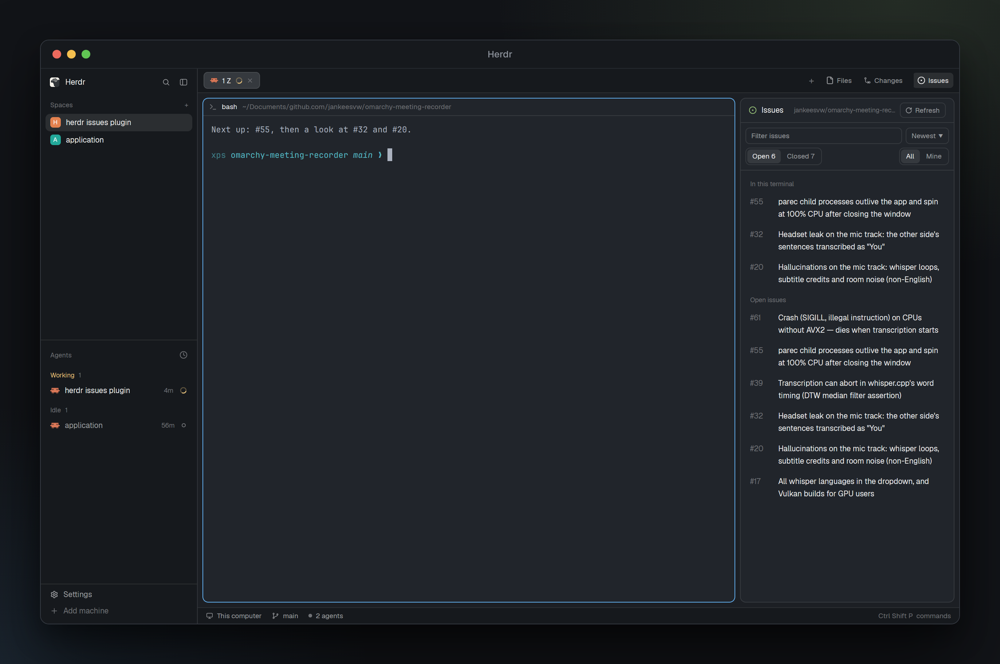

# Herdr Issues

A side panel beside Files and Changes that lists the issues and pull requests of the repository the focused terminal is in — on GitHub or on Gitee — with the issue idents that terminal mentions at the top, and a GitHub-style view of one, in the panel where the list was, to comment, edit its labels, assign yourself, close and reopen it.

## What you see

- **The Issues button**, at the right end of the tab bar after Files and Changes: a 26px pill with a circle-dot icon and "Issues", `selected` while its panel shows, `chrome` otherwise, like the tab bar's own panel buttons.
- **The panel**, in the side panel column (368px by default) as a card: 10px radius, 1px `border`, `background`.
  - A 42px header: a green (`ansi2`) circle-dot icon, "Issues" semibold, a 18px "Gitee" tag on Gitee (10px `dim` text, 1px `border`), the repository (`owner/name`, 11px, `dim`, truncated, right-aligned) and a bordered "Refresh" button with a round arrow icon, or a spinner and "Syncing".
  - A filter area, three rows: a text field ("Filter") with a sort button ("Newest ▼"); a segmented "Issues | PRs" on the left and "All | Mine" on the right; and "Open 177 | Closed 100" across.
  - The list: rows of `#number` (40px wide, `dim`; 62px on Gitee, whose idents are `#IKS135`) and the title (wrapping). When the focused terminal mentions issues, an "In this terminal" heading comes first with those rows (closed ones with a purple `ansi5` number), then a heading for the list below.
  - Before any repository has been seen: a centered circle-dot icon, "No repository yet" and "Focus a terminal inside a GitHub or Gitee repository and its issues show up here."
- **The item view**, in place of the list (no dialog, nothing over the terminals), drawn after github.com's issue page:
  - A top bar: a "List" button (a "Back" one after following a link), the repository, an error if the last action failed, a spinner while refreshing or saving, and Refresh, Copy and Open on GitHub (Open on Gitee there) buttons.
  - Narrow (under 620px wide, as the 368px panel is) the padding drops from 32 to 14, the title from 28 to 20px, and the sidebar is replaced by a line of label chips, milestone and assignee under the title. Under 430px ("tight") the repository leaves the top bar, the "Markdown is supported" hint goes, "Close with comment" becomes "Close", and the footer wraps its buttons rather than clipping them.
  - The title at 28px (20 narrow), regular weight, wrapping word by word with a `muted` `#123` (or `#IKS135`, `!14`) after its last word. A title with CJK in it has no spaces to wrap at: it is one wrapping text block with the reference under it instead. Below it a 32px state pill in GitHub's fixed colors (white on `#238636` Open, `#8957e5` Closed or Merged, `#6e7681` not planned) — on Gitee the issue's own state name and color from `issue_state_detail` (意向, 进行中, 已完成, 已拒绝) — and an outlined pill per linked pull request.
  - Left, the timeline: full-width cards (6px radius, `border`) with a 38px `raised` header holding a 20px avatar, the login, "opened on Sep 26" or "29d ago", and pills for bot, Author and the GitHub role (Owner, Member, Contributor). Below the markdown, reaction pills (emoji and count). Events sit between the cards on a 2px line 20px in: a 28px round icon (tag, person, pencil, signpost, link, commit; filled purple for closed, green for reopened, grey for not planned), a 16px avatar, the bold login and what happened ("added Bug label", "closed this as completed", "mentioned this" with the referencing issue or pull request below, "added a commit that references this issue" with its short SHA). Then "Add a comment": a card with Write and Preview tabs, a textarea growing from 4 to 14 rows, "Close issue" (with a ▾ for completed or not planned; GitHub only — Gitee's API can't set its rejected state) or "Reopen issue", and a green "Comment" button. On Gitee: the body and the comments only — no events, reactions or roles, since its API has none.
  - Right, a 264px sidebar of sections split by lines: Assignees ("No one · Assign yourself"), Labels (GitHub-style chips, with Edit), Milestone, Development (the linked pull requests; "Gitee doesn't list these" on Gitee) and Participants (avatars).
- **The copy menu**, a 300 by 222 popup: Copy link, Copy reference (`owner/repo#27`), Copy number (`#27`) and Copy number and title, each with the text it copies below it.
- **The sort menu**, a popup: "Sort by" and Newest, Oldest, Recently updated, Least recently updated, Most commented, with a check on the current one.

## How it behaves

- The panel follows the focused terminal's folder (`panes()[i].cwd`), resolved from its git remotes (`git remote -v`) to `{ provider, repo }`: GitHub's remote wins over Gitee's when a folder has both, and another host is ignored. The result is kept per folder in `localStorage`. Each space remembers the repository its terminals were last in (across restarts): a folder outside any repository keeps it, and a space that never had one shows the empty state, never another space's repository.
- A repository's issues show at once from the cache. The first time, and every 6 hours, the panel fetches all open issues (up to 300) and the 100 most recently closed, in full. Every 30 seconds in between it fetches only issues updated since the last sync, two minutes of overlap, and merges them: GitHub takes `--search updated:>=…`, Gitee `since` in either state. Refresh syncs now.
- While the panel isn't the shown side panel, it doesn't sync or read terminals; showing it syncs at once.
- Every 3 seconds it reads the focused terminal (`hc read --lines 300`) for `#123` (GitHub) or `#IKS135` (Gitee) and links to the repository's issues or pull requests, newest line first and each line left to right, up to 8. Idents that aren't open issues are looked up once (`gh issue view`, or Gitee's issue endpoint) and remembered, including ones that don't exist.
- Filtering matches `#number` and title. Mine keeps issues assigned to the `gh` user. The counts on Open and Closed are of the cache.
- The list is of the kind the switch shows: issues, or pull requests (merged ones as Merged, drafts as Draft). Each kind has its own cache file and sync.
- Clicking a row shows that item in the panel, in place of the list, from the cache at once and refreshed behind it; List returns to the list. Switching space, kind or repository drops it.
- In the view, `#123` (or `#IKS135`) and `owner/repo#123` outside code are links: issue and pull request links on this item's own platform open here, with Back; other links, and other platforms', open in the browser.
- Opening an item loads it in full (`gh issue view` or `gh pr view` with milestone, linked pull requests and reactions) and its timeline (`gh api --paginate --slurp repos/…/issues/N/timeline`); label changes by one person within a minute are one line, and project and subscription events are left out. Gitee loads the issue and, in another request, its comments, which the same timeline drawing shows as comment cards. Avatars are downloaded once (`curl` from the `avatar_url`, else `github.com/<login>.png`) into `data/issues/avatars/`; bots without one get an initial.
- Images in a body or comment (``, ``, outside code) are cut out of the markdown, which draws none, and drawn between its runs: downloaded once into `data/issues/images/`, measured from the file's header (PNG, JPEG, GIF, WebP, SVG), at their width attribute or own width but never wider than the thread column. github.com URLs (private repositories' attachments) go with the `gh` token, piped to `curl -H @-` and dropped by curl on the redirect to GitHub's storage host. Clicking one opens the file.
- Copy (in the issue's top bar, or right-clicking a row in the panel) opens the copy menu; picking a line writes it to the clipboard (`cx.write_to_clipboard`) and shows a "Copied" toast.
- Comment posts the box (also Ctrl+Enter); Preview renders it. Close and Reopen take the box's text along as a comment (on Gitee: the comment first, then `state` = `closed` or `open`). Edit on the first card swaps the title for a field and the body for an editor in place, with Cancel and Save under them, and only on an item whose author you are (a repository's permissions are never fetched); the sidebar's Edit lists the repository's labels with a check on the issue's; clicking one adds or removes it at once (Gitee takes the whole comma-separated list back). Every change goes through the issue's platform, then reloads the issue and tells the panel through shared state (`issues.changed`), which fetches that one issue so the list is current.
- The tab bar remembers each space's side panel only if it's in shared `workspace.panels`; the button adds `issues` there.

## Built from

- **Layout** (`layouts/main-issues.json`): Herdr's `main` 0.1.9. The `tabs` block sits in a 42px row `tab-bar` with a 78px block `issues-button` (`{ mod: "issues", props: { button: true } }`, `window_drag`). The `panel-body` stack gets a third child `issues` (`{ mod: "issues" }`).
- **Mod** `mods/issues/`: `main.js` is the panel and the button (props `button`), the sort menu (overlay props `sortMenu`), the copy menu and the item view — it builds a `viewer.js` `Viewer` for one item and renders it where the list was (`Viewer({ repo, provider, kind, number, on, data, me }, cx, { onBack })`). `api.js` reads the platform out of a remote's URL and hands out its provider; `github.js` and `gitee.js` answer the same calls — `items`, `view`, `timeline`, `me`, `comment`, `setState`, `assign`, `labels`, `toggleLabel` — the first through `gh`, the second through Gitee's API v5 and the token file, both mapping to what the panel reads (`order`, `stateText`, `stateColor`, `commentCount`). `icons.js` writes its Lucide icons to `data/issues/icons/` and downloads avatars to `data/issues/avatars/`; `pictures.js` splits markdown around its images and downloads and measures them. The copy menu is overlay props `copyMenu: { url, provider, ref, number, title }`. Start work is a dialog of its own: `start.js` takes overlay props `start: { repo, provider, kind, number, ref, title, url, body, head, base, folder, on }` and draws the harness, its model, the reasoning effort, the branch with its worktree path, and the brief; then it makes the worktree and the space. `agents.js` says how each harness takes a model and an effort (`claude --model … --effort …`, `codex -m … -c model_reasoning_effort=…`, `pi --model … --thinking …`, the rest `--model …`) and lists its models by running the CLI (`codex debug models`, `opencode models`, `cursor-agent --list-models`, `pi --list-models`).
- **herdr**: `spaces`, `panes`, `focused`, `layout`, `theme`, `exec` (`git remote -v`, `gh`), `fetch` (Gitee, in `gitee.js`), `hc`, `knownAgents`, `home`, `notify`, `run` (`layout.select`, `layout.show`, `layout.hide`, `space.new`, `space.select`), `openOverlay`, `closeOverlay`, `props`, `shared` / `setShared` (`issues.sort`, `issues.changed`, `workspace.panels`), `appHome`, `localStorage` (repositories per folder, the login per platform, the last repository), `fs/promises` (the cache, the Gitee token).
- **gpui-base**: `TextView.markdown` with `on_link_click`, `TextareaState` / `Textarea`, `InputState` / `Input`, `EditorState` / `Editor`.
- **Programs**: `gh` (`repo view`, `api user`, `issue list`, `issue view`, `issue comment`, `issue close`, `issue reopen`, `issue edit`, `api --method PATCH repos/…/issues/N` (an item's title and body), `label list`, `api …/timeline`), `curl` (avatars and images).
- **Gitee API v5** (issues), and its pull request twins `GET /repos/{o}/{r}/pulls` (`state` open|closed|merged|all, `since`), `GET …/pulls/{number}`, `GET|POST …/pulls/{number}/comments`, `PATCH /repos/{o}/{r}/pulls/{number}` (`state`, `labels`, `title`, `body`): `GET /repos/{o}/{r}/issues` (`state`, `sort`, `direction`, `since`, `page`, `per_page` ≤ 100), `GET …/issues/{number}`, `GET …/issues/{number}/comments`, `POST …/issues/{number}/comments`, `PATCH /repos/{owner}/issues/{number}` (`state`, `assignee`, `labels`, `title`, `body`, and `repo` = the repository's name in the body), `GET …/labels`, `GET /user`. Reads take `access_token` in the query, writes in the form body.

## Watch out

- Herdr doesn't draw SVGs or images from a symlinked mod folder (JavaScript loads fine), so icons and avatars live in the data folder and are drawn only once they're on disk; drawing a missing file first would leave it blank.
- The markdown view (`TextView.markdown`) draws no images at all, not even the alt text.
- A `Textarea` given a height (`h_full()`, `.h(...)`) inside a bordered box shows its first line half cut at the top: its own scroll viewport and the box's padding disagree. The widget that fills a box and scrolls cleanly is `Editor` — `EditorState.new({ language, soft_wrap, line_numbers: false })` and `Editor.new(state).flex_1().min_h(0)`, exactly as the `files` mod shows a long file. `h_full()` on a child of a padded container also overflows the padding by exactly that padding.
- A button whose enabled state depends on an input needs `Input.on("change", ...)` plus `cx.notify()`: the input repaints itself, not the view around it.
- Writing an issue: `gh issue create -R <repo> --title .. --body ..` prints the new issue's URL and nothing else, so the number is its tail; Gitee wants `repo` (the name without the owner) in the body of `POST /repos/{owner}/issues` and answers with the row. Gitee's API has no way to delete an issue (DELETE answers 405 Not Allowed): a test issue has to be deleted from the web UI's 删除 · 确认, or closed and left there.
- A panel's mod instance survives a layout switch back to the same layout: new code only reaches it through a *different* layout name (a copy of the file), which is also the only way to see a change without a click.
- `space.new` is the whole of "start an agent here": `{ name, folder, tab, argv, task, machine }`, where `argv` is the program as an array (`agent.run` from `knownAgents()`) and `task` is its first message. The shipped worktree mod uses `{ folder, tab, argv }` and has no `task`; a dialog that makes the worktree itself can hand the agent its brief, which is what Start work does, with `tab` naming the tab after the harness.
- A mod's `fs` writes are limited to its granted roots: writing `/tmp` or even `appHome()/data/...` can be refused under `herdr-app check` while `exec("sh", ...)` runs with the real environment. For a trace, `exec` a heredoc; for the payload, `exec` a `cat > file`.
- Worktrees: `<home>/.herdr/worktrees/<repo>/<branch with slashes as dashes>`, from the main checkout (`git rev-parse --path-format=absolute --git-common-dir`, minus `/.git`). Which add depends on the branch, so the second press can't fail: an existing local branch is reused (`worktree add <path> <branch>`), one only on origin is tracked (`--track -b <branch> <path> origin/<branch>`), and a new one starts from `origin/<default>` (`-b <branch> <path> <base>`), never from whatever the main checkout happens to be on. A space already at that folder is opened instead of making a second worktree, which is also why Start turns into "Open space".
- There's no inline styled text: the title is one element per word in a wrapping row, so the muted number can follow its last word. That only works for text that breaks at spaces — CJK needs the wrapping-block path, or a long Chinese title runs off the panel.
- Width is the only responsive input there is: no CSS, no media queries, everything is `this.width` from `.on_size_change` on the root, with two breakpoints (620 narrow, 430 tight). Layout-file sizes beat `layout.resize`, so testing a narrow panel means a scratch layout with a small `size.px`.
- Saving a mod file reloads it; a dialog that was loading at that moment shows "interrupted". Reopen it.
- Herdr doesn't dock a symlinked mod from `mod.json`; `place` is `none` and the layout places it.
- `init`'s first argument isn't the overlay's props: read them with `props()`.
- The cache file holds full issues (bodies and comments) and is around 1 MB for 400 issues. A cache without `version: 3` (before Gitee, in other words) starts with a full fetch.
- GitHub search can lag a few seconds behind a change, which the two minute overlap covers; the dialog's own changes don't wait for it.
- Pull requests open in the dialog read-only: no comment box, labels or state buttons.
- Gitee idents are strings (`IKS135`), so "Newest" sorts on Gitee's numeric `id` (`order` in the mapping) and nothing may do arithmetic on `number`. A pull request's number is numeric and shows as `!14`.
- Gitee pull requests have reviewers, not an assignee (`assignable(kind)` is false for them), no comment count anywhere in the API, and a merged state of their own; a closed one reads as not planned. Their comments endpoint also returns the code review comments, which are dropped (they have a `path`).
- GitHub's `gh` knows all of it: `pr list`, `pr view`, `pr comment`, `pr close`/`pr reopen`, `pr edit`. `pr close` has no `--reason`, so only issues are offered "not planned".
- Gitee lists `per_page` no higher than 100 (300 is refused), and `state=closed` leaves out rejected issues: the panel fetches `open`+`progressing` and `closed`+`rejected` as two streams and merges them.
- Gitee's API won't set its rejected state (400 "state does not have a valid value"), so the dialog offers only "Close issue" there; rejected issues that exist still read as not planned. `state` also carries `progressing`, which is what 进行中 is.
- Gitee updates an issue through its owner, not its repo: `PATCH /repos/{owner}/issues/{number}` with `repo` in the body. The repo-segment path (`/repos/{owner}/{repo}/issues/{number}`) answers "Not Found Project" for a PATCH, which reads like a permission problem and isn't one. A `PATCH` changes only what it is given, hence the whole label list on a label change.
- Editing an item: GitHub's `PATCH /repos/{repo}/issues/{number}` takes a pull request's title and body as well, so one `gh api` call covers both kinds (`-f title=… -f body=…`; `exec` has no stdin, so a body can't go through `--input -`). Gitee splits them as it does everywhere else: an issue through the owner path, a pull request on its own endpoint.
- Gitee's label list can repeat a name (enterprise labels); the picker keeps the first of each. Colors come with no `#` on labels and with one in `issue_state_detail`.

## Done when

- `herdr-app check ~/.config/herdr-app/mods/issues` passes.
- The tab bar shows Files, Changes and Issues; Issues opens and closes the panel, and switching spaces restores it.
- In a terminal inside a GitHub repository, the panel lists its open issues; Closed, Mine, the filter and each sort order change the list.
- `echo "#12"` in that terminal puts #12 under "In this terminal" within 3 seconds.
- A row shows the item in the panel at once, with the list behind it on List; a `#number` link in the body opens that one with Back.
- The Issues | PRs switch lists pull requests, merged ones as Merged; `!14` rows are Gitee's, `#7` GitHub's.
- Read an issue, press Start work: a dialog over the panel offers Agent (the harnesses installed here), its models, Reasoning, a branch already filled with `issue/12-<slug>` and the path it will be checked out at, and the brief in Chinese with Edit and Reset. Press Start: `~/.herdr/worktrees/discount-calculation/issue-12-<slug>` exists, `git worktree list` shows it, a space opens there with a tab named after the harness, and the agent's first message holds the title, the body and its quotes/backticks/$HOME untouched.
- Change the branch to one that exists, to one that is only on origin, to a name git refuses and to one another worktree has checked out: the line under it reads `exists: reused`, `on origin: starts from it`, `not a branch name`, `checked out in another worktree`, and Start is dim for the last two.
- On a pull request the dialog opens on Review with Fix beside it: Review's brief says read only and starts from the PR's head (`gh pr checkout <n> --detach`, `git fetch origin pull/<n>/head` on Gitee), Fix's leads the branch to that head and asks for one commit per comment. Neither tells the agent to push.
- Press +: the list gives way to a Title field, a body editor and Create issue, dim until the title has something in it; Cancel comes back. Paste 40 lines into the body: it starts at the first line whole, keeps whole lines, and scrolls inside the box instead of pushing past it. Create makes a real issue on the platform that is listed afterwards and opens in the panel.
- Open the same one again: the dialog's branch line says `already open in a space` and its button reads Open space; pressing it comes forward, no second checkout, no error.
- Narrow the panel to 300px: the title still wraps with its number on a line of its own, the top bar keeps only List and its icons, and Close and Comment both fit.
- A comment, a label change, close and reopen show on github.com and in the panel's list.
- Edit on the first card of an issue you wrote: the title becomes a field and the body an editor, Save dim while the title is empty; change both, Save, and the panel shows the new title and body, github.com/gitee.com too, and GitHub's timeline gains "changed the title". On someone else's issue there is no Edit, and Cancel leaves the item as it was.
- In a folder whose only remote is gitee.com, the header shows a Gitee tag and its repository, and the panel lists its issues; `echo "#IKS135"` puts that issue under "In this terminal" within 3 seconds.
- A Gitee issue opens with its own state pill (已完成, 已拒绝), its comments and its labels, and a comment, a label change and close as completed show on gitee.com and in the list.
- A folder with a remote on both platforms keeps showing GitHub's repository, as before.
